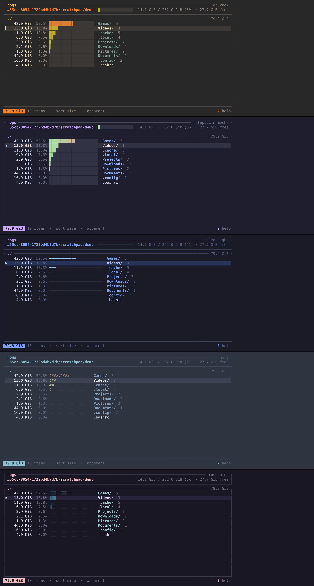

# hogs

**Find what's hogging your disk.** `hogs` is a terminal app that shows which folders and files are eating your space, sorted by size, with a bar for each one. It's written in Rust, runs anywhere a terminal does, and is built to be riced: every color, border and bar is a theme you can edit live.



## Why hogs

- **Very lightweight.** One small binary, about 1.7 MB. It has no daemon, no config it needs, and no background process. On a sample scan of `/usr` (about 160,000 files) it finished in around 2 seconds using roughly 36 MB of RAM. Those numbers are from one test machine, so your results will vary.
- **Fast to read.** A sorted tree with usage bars, drill in and out with vim keys, and a filesystem gauge in the header so you see the whole picture at a glance.
- **Accurate.** Shows disk usage *and* apparent size, counts hard links once, and never follows symlinks, so totals don't lie.
- **Safe.** `d` moves things to the trash, never deletes outright, and always asks first.
- **Riceable.** Themes are plain TOML files: colors, border style, bar glyphs, gradients, selector, and transparency so your blur shows through. Edit a theme while hogs is open and it reloads on save.

## Themes

Five themes ship with hogs. Press `t` in the app to cycle through them.

| Theme | Look |
|---|---|
| `gruvbox` (default) | Warm retro, high contrast |
| `catppuccin-mocha` | Soft pastels on deep base |
| `tokyo-night` | Neon on midnight blue, thin bars |
| `nord` | Arctic and calm, ASCII bars |
| `rose-pine` | Muted and dreamy, dotted bars |

Pick one with `hogs -t tokyo-night`, or start from any of them with `hogs --dump-theme nord > ~/.config/hogs/themes/mine.toml`. The full theme reference is further down.

## Install

```bash
cargo install --path .
# or
cargo build --release && cp target/release/hogs ~/.local/bin/
```

Needs Rust 1.87+.

## Usage

```bash
hogs              # scan the current directory
hogs ~            # scan your home
hogs -x /         # whole root filesystem, without crossing into other mounts
hogs -e .git -e node_modules ~/Projects
hogs --print ~    # top 20 to stdout, no TUI
```

| Key | Action |
|---|---|
| `j` `k` / `↓` `↑` | move |
| `l` `→` `Enter` | open folder |
| `h` `←` `Backspace` | go up |
| `g` / `G` | top / bottom |
| `Ctrl-d` / `Ctrl-u` | half page |
| `s` | sort: size → name → items |
| `a` | disk usage ↔ apparent size |
| `.` | show / hide dotfiles |
| `/` | filter by name |
| `d` | move to trash (asks first) |
| `o` | open with `xdg-open` |
| `t` / `T` | next / previous theme |
| `r` | rescan |
| `?` | help |
| `q` | quit |

## Ricing

Bundled themes: `gruvbox` (default), `catppuccin-mocha`, `tokyo-night`, `nord`, `rose-pine`.
Press `t` inside hogs to cycle through them.

Make your own:

```bash
mkdir -p ~/.config/hogs/themes
hogs --dump-theme gruvbox > ~/.config/hogs/themes/mine.toml
hogs -t mine
```

Keep hogs open in one terminal and your theme in an editor in another: every save reloads instantly.

### Theme reference

Every key is optional; missing ones fall back to Gruvbox.

```toml
[colors]
background   = "#282828"   # "transparent" works too
foreground   = "#ebdbb2"
dim          = "#928374"   # secondary text: percentages, counts, hints
accent       = "#fe8019"   # footer pill, filter, highlights
title        = "#fabd2f"   # panel titles
border       = "#504945"
directory    = "#83a598"
file         = "#ebdbb2"
symlink      = "#8ec07c"
selection_bg = "#3c3836"
selection_fg = "#fbf1c7"
danger       = "#fb4934"   # trash dialog, errors
warning      = "#fabd2f"
bar_low      = "#b8bb26"   # bar color for small entries...
bar_high     = "#fb4934"   # ...blending to this for big ones
bar_empty    = "#3c3836"   # the unfilled track

[style]
border      = "rounded"   # rounded | plain | double | thick | none
bar         = "blocks"    # blocks | thin | ascii | dots
gradient    = "size"      # size: one color per bar | position: fades along the bar
bar_width   = 20          # 4–60
transparent = false       # let Hyprland blur / terminal opacity show through
icons       = false       # Nerd Font icons
selector    = "▌ "
```

Colors can be `#rrggbb`, names (`red`, `lightblue`), or 256-color indexes (`"141"`).
Typos are reported in the footer rather than silently ignored.

### Config

`~/.config/hogs/config.toml`:

```toml
theme = "mine"
show_hidden = true          # default true: ~/.cache is usually the culprit
apparent_size = false
one_filesystem = false
exclude = [".git", "node_modules"]
color = "auto"              # auto | truecolor | 256 | none
```

`NO_COLOR` is respected.

### Previewing a theme without a terminal

```bash
cargo run --example preview -- mine ~ > preview.html
```

## How it works

The scanner walks the tree once with an explicit stack (no recursion) and stores every entry in a flat arena (`Vec<Node>` linked by index), then sums sizes bottom-up in a single reverse pass. The scan runs on a background thread while the UI shows live progress.

## License

MIT
